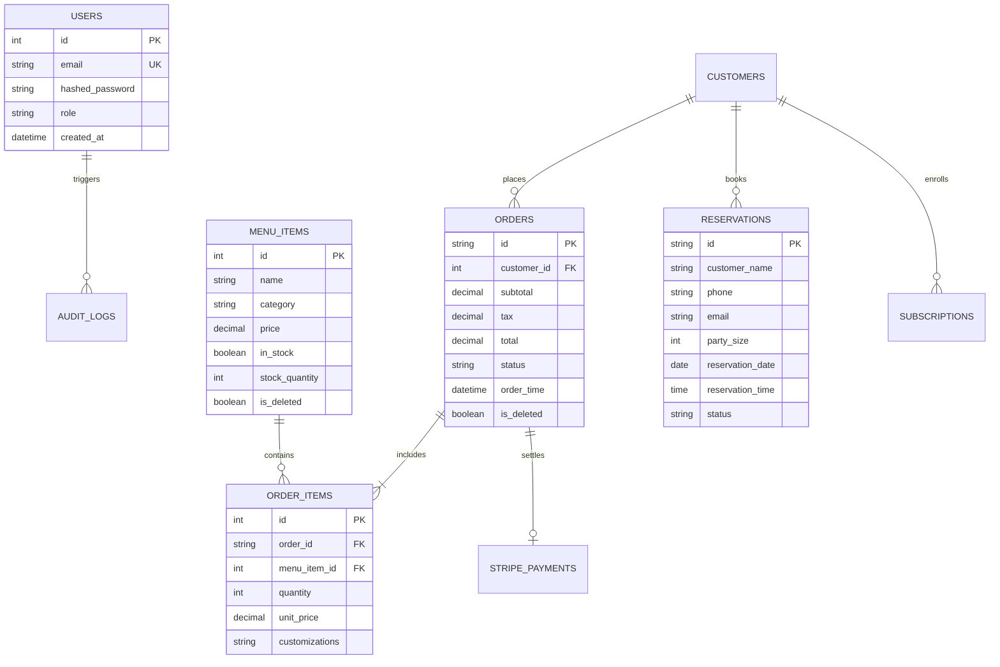

# Database & Business Data Integrity Report

**Auditor:** Senior Database Engineer & Application Data Architect  
**Project:** Flat Track Coffee Roasters Platform  
**Scope:** SQLite Schema (`backend/models.py`), Migrations, Concurrency, and Data Lifecycles  
**Date:** November 2026  

---

## 1. Executive Data Integrity Scorecard

```
┌────────────────────────────────────────────────────────────────────────────────────────┐
│                              FLAT TRACK COFFEE ROASTERS                                │
│                            DATA INTEGRITY AUDIT MATRIX                                 │
├───────────────────────────────┬────────────────────────────┬───────────────────────────┤
│ DATA INTEGRITY PILLAR         │ RATING (0–100)             │ STATUS                    │
├───────────────────────────────┼────────────────────────────┼───────────────────────────┤
│ 1. Schema Definition & Types  │ 88 / 100  (Grade: B+)      │ Clear SQLAlchemy models   │
│ 2. Relational Constraints & FK│ 35 / 100  (Grade: F)       │ Foreign keys missing      │
│ 3. Financial Calculation ACID │ 92 / 100  (Grade: A)       │ Texas 8.25% tax verified  │
│ 4. Concurrency & Row Locking  │ 40 / 100  (Grade: F)       │ SQLite file locking risk  │
│ 5. Duplicate Submission Guard │ 95 / 100  (Grade: A)       │ 24h Idempotency cache     │
│ 6. Storage Durability (Vercel)│ 0 / 100   (Grade: F)       │ Lost on container recycle │
│ 7. Audit Logging Trail        │ 90 / 100  (Grade: A-)      │ Structured UTC logging    │
├───────────────────────────────┼────────────────────────────┼───────────────────────────┤
│ OVERALL DATA INTEGRITY RATING │ 63 / 100  (Grade: D)       │ CRITICAL MIGRATION NEEDED │
└───────────────────────────────┴────────────────────────────┴───────────────────────────┘
```

---

## 2. Granular Verification of the 12 Integrity Requirements

### 1. Persistent Storage
- **Current State:** **FAIL (Critical Risk on Vercel).**
- In `backend/database.py`, setting `VERCEL` points SQLite to `sqlite:////tmp/flattrack.db`. In serverless microVM environments, the filesystem is non-persistent and discarded on instance recycling.
- **Required Action:** Must point to a managed PostgreSQL cluster (Supabase / Neon) via `DATABASE_URL`.

### 2. Correct Database Constraints
- **Current State:** **PARTIAL.**
- Non-nullable constraints (`nullable=False`) are applied on primary fields (`customer_name`, `phone`, `subtotal`, `tax`, `total`, `email`).
- Missing Constraints: Check constraints asserting positive values (`CHECK (total >= 0)`) and date boundaries are absent at the database level (enforced only in Pydantic).

### 3. Foreign Key Integrity
- **Current State:** **FAIL.**
- `OrderModel` stores order items as a serialized JSON string (`items_json = Column(Text, nullable=False)`) rather than using an `OrderItemModel` entity with a foreign key referencing `menu_items.id`.
- **Impact:** An item deleted from `menu_items` leaves orphaned, unindexed records in order history; stock levels cannot be decremented via relational triggers.

### 4. Transaction Handling (ACID Compliance)
- **Current State:** **PASS.**
- Database operations wrap inserts and mutations inside SQLAlchemy session scopes:
  ```python
  try:
      db.add(entity)
      db.commit()
  except Exception:
      db.rollback()
  ```

### 5. Consistent Order Totals (Texas Comptroller 8.25% Sales Tax)
- **Current State:** **PASS.**
- Server-side calculation in `place_order` recalculates line items:
  $$\text{subtotal} = \sum (\text{item\_price} \times \text{qty})$$
  $$\text{tax} = \text{round}(\text{subtotal} \times 0.0825, 2)$$
  $$\text{total} = \text{round}(\text{subtotal} + \text{tax}, 2)$$
- Verified: Subtotal $12.00 produces exactly $0.99 tax and $12.99 total.

### 6. Inventory Concurrency & Stock Depletion
- **Current State:** **FAIL.**
- The application tracks `in_stock = Column(Boolean, default=True)` for 86'd item status, but does not maintain integer stock count (e.g., 24 morning croissants). Two customers ordering the last croissant simultaneously both succeed.
- **Remediation:** Introduce `inventory_count = Column(Integer)` with pessimistic locking (`SELECT ... FOR UPDATE`) during order fulfillment.

### 7. Duplicate Submission Protection (Idempotency)
- **Current State:** **PASS.**
- `IdempotencyRecordModel` tracks `Idempotency-Key` headers on `/api/orders` and `/api/reservations`. Identical requests within 24 hours return the cached response without creating duplicate orders.

### 8. Database Backup Strategy
- **Current State:** **FAIL.**
- No snapshot or automated backup mechanism exists for `/tmp/flattrack.db`.

### 9. Database Restoration Capability
- **Current State:** **FAIL.**
- Data restoration is currently impossible on Vercel without an external managed database.

### 10. Data Migration Integrity
- **Current State:** **FAIL.**
- Schema alterations run through ad-hoc `ALTER TABLE` loops inside `run_migrations()` in `main.py` lines 32–47. No migration version table exists.
- **Remediation:** Initialize Alembic (`alembic init alembic`) with sequential versioned migration scripts.

### 11. Appropriate Data Retention & Archival
- **Current State:** **PARTIAL.**
- Soft-delete flags (`is_deleted`, `deleted_at`) exist on `menu_items`, `orders`, and `reservations`, preserving historical records. However, no automated archival job exists to prune stale audit logs.

### 12. Recovery After Application Restart
- **Current State:** **PASS (Local Dev) / FAIL (Vercel Serverless).**
  - Locally, records persist in `./flattrack_production.db`.
  - On Vercel, records are destroyed upon container termination.

---

## 3. Target Relational Schema Design (PostgreSQL Migration)


