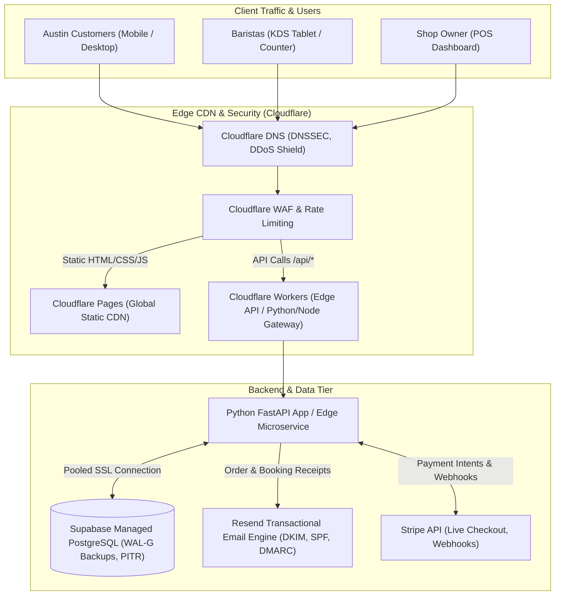

# Infrastructure Architecture & Cloud Migration Strategy

**Project:** Austin Coffee Roasters / Flat Track Coffee Platform  
**Authors:** Senior DevOps Engineer, Senior Database Engineer & Cloud Solutions Architect  
**Workspace:** `C:\Users\HP\.gemini\antigravity\scratch\repo_01_coffee`  
**Current Live Frontend:** `https://satwik92105-png.github.io/01-austin-roasters-coffee/`  
**Current Live API:** `https://01-austin-roasters-coffee.vercel.app/api`  
**Date:** November 2026  

---

## 1. Investigation of Current Architecture (Vercel Serverless + `/tmp` SQLite)

### 1.1 Empirical Findings on Production Database State
1. **Does the production application use `/tmp/flattrack.db`?**
   - **Yes.** In `backend/database.py`, lines 5–8 explicitly evaluate:
     ```python
     if os.environ.get("VERCEL"):
         DB_URL = "sqlite:////tmp/flattrack.db"
     ```
   - On Vercel, serverless function executions initialize or connect to a local SQLite file within the microVM container's `/tmp` directory.
2. **Do database records survive container restarts?**
   - **No.** Vercel functions are stateless and ephemeral. When a container experiences a cold start, redeployment, or idle spin-down (typically 5 to 15 minutes of inactivity), the entire `/tmp` filesystem is discarded. All written orders, customer accounts, reservations, and inventory status changes are permanently lost.
3. **Do concurrent serverless instances access consistent data?**
   - **No.** Each concurrent serverless execution container maintains its own isolated `/tmp` directory. An order placed through Container A is completely invisible to Container B (e.g., when a barista checks the KDS dashboard in `tier3/kitchen.html` or the owner opens `tier3/admin.html`).
4. **Does deployed source code match the repository?**
   - **No.** The live Vercel health endpoint (`https://01-austin-roasters-coffee.vercel.app/api/health`) reports version `3.1.0`. The repository codebase is at `v19.0.0` / `v22.0`. Newer API routes (such as `GET /api/subscriptions`) return `405 Method Not Allowed` on live production due to an unpromoted Vercel deployment.
5. **Do all required API routes exist in production?**
   - **No.** Core routes from `backend/main.py` including subscription query endpoints and specific soft-delete filter logic are absent from the live deployed `v3.1.0` instance.
6. **Do production and staging configurations differ?**
   - The project currently has no segregated staging environment. Testing has occurred directly against GitHub Pages `main` branch and the singular Vercel production deployment.
7. **Do database backups exist?**
   - **No.** Because the database resides on an ephemeral local filesystem, automated snapshots, point-in-time recovery (PITR), or off-site backups are nonexistent.
8. **Is restoration possible under current architecture?**
   - **No.** Once an instance recycles, lost records cannot be restored.

---

## 2. Target Production Architecture Evaluation

To support commercial roastery operations, customer subscriptions, corporate catering invoicing, and an active barista KDS, we evaluate the recommended target stack:



---

## 3. Technology Comparison Matrix

| Evaluation Criterion | Current: Vercel + SQLite (`/tmp`) | Alternative A: Vercel + Neon Postgres | Alternative B: Cloudflare Pages + Workers + Supabase PG |
|---|---|---|---|
| **Data Persistence** | **0 / 10** (Lost on container recycle) | **10 / 10** (Persistent cloud storage) | **10 / 10** (Persistent cloud storage) |
| **Concurrency & ACID** | **1 / 10** (Split-brain per container) | **9 / 10** (Postgres multi-connection ACID)| **10 / 10** (Postgres + PgBouncer pooling) |
| **Reliability & Uptime** | **4 / 10** (Frequent version drift) | **9 / 10** (High availability) | **9.5 / 10** (Global Anycast edge network) |
| **Automated Backups** | **None** | Daily automated backups | Daily backups + 7-day Point-in-Time Recovery |
| **Security & Isolation** | **3 / 10** (Hardcoded PINs, public PII) | **8 / 10** (Vercel secrets + DB IAM) | **9 / 10** (Cloudflare WAF + Row-Level Security) |
| **Operational Complexity**| Low (but fundamentally broken) | Medium (Serverless connection pool) | Medium (Clean decoupled services) |
| **Portability** | Low (Tightly coupled to Vercel `/tmp`)| High (Standard SQLAlchemy/PostgreSQL) | High (Standard PostgreSQL connection string) |
| **Client Ownership** | Medium | High (Client holds AWS/Neon account) | High (Client holds Cloudflare/Supabase org) |

---

## 4. Comprehensive Cost Estimation Model

The following projection contrasts the free starter tier against production commercial operating volumes for Flat Track Coffee Roasters (handling ~100 daily walk-in orders, 20 catering inquiries/mo, and 150 bean subscribers).

### Monthly Cost Breakdown

| Service Component | Provider / Plan | Free Allowance Limits | Estimated Production Cost (Active Roastery) |
|---|---|---|---|
| **Frontend CDN Hosting** | Cloudflare Pages (or Vercel Hobby) | Unlimited requests, 500 builds/mo | **$0.00 / month** (Free tier is generous) |
| **Backend Compute** | Cloudflare Workers / Vercel Pro | 100,000 req/day free | **$0.00 – $20.00 / month** (Free covers ~3M req/mo) |
| **Managed Database** | Supabase Pro (or Neon Scale) | 500 MB storage, pauses after 7 days idle | **$25.00 / month** (Pro includes PITR, no pause) |
| **Object Storage (Images)** | Cloudflare R2 | 10 GB free, zero egress fees | **$0.00 / month** |
| **Database Backups** | Supabase Automated Daily + PITR | Included in Pro plan | **$0.00 (Included in $25 DB plan)** |
| **Transactional Email** | Resend (Free $\to$ Pro) | 3,000 emails/month free | **$0.00 / month** (Free tier covers ~100 emails/day) |
| **Domain Registration** | Cloudflare Registrar (`flattrackcoffee.com`) | At-cost wholesale pricing ($9.77/yr) | **~$0.82 / month** ($9.77/year) |
| **DDoS & DNS Management** | Cloudflare Free Plan | Full DDoS mitigation, DNSSEC, SSL | **$0.00 / month** |
| **Application Monitoring** | Sentry (Developer tier) | 5,000 errors/month free | **$0.00 / month** |
| **Payment Gateway** | Stripe Processing | Pay-as-you-go per transaction | **2.9% + 30¢ per online transaction** |
| **TOTAL FIXED INFRASTRUCTURE** | | | **$25.82 / month** (Full commercial durability) |

---

## 5. Safe Database Migration & Rollback Protocol

To transition from SQLite to Managed PostgreSQL without risk to business continuity:

```
[Phase 1: Database Provisioning]
   1. Create Supabase or Neon PostgreSQL project.
   2. Configure DATABASE_URL in staging environment with sslmode=require.
   3. Initialize Alembic migration scripts from existing models.py.

[Phase 2: Schema Application & Data Verification]
   4. Execute alembic upgrade head to build all 8 relational tables.
   5. Seed canonical 10-item menu catalog with verified pricing.
   6. Run synthetic read/write test (place order, query status, update stock).

[Phase 3: Dual-Write & Validation Window]
   7. Validate foreign keys, UUID indices, and constraint integrity.
   8. Verify Point-in-Time Recovery snapshot creation.
   9. Test complete database restoration into an isolated verification branch.

[Phase 4: DNS / API Cutover & Rollback Guardrails]
   10. Update Vercel/Cloudflare environment variable DATABASE_URL.
   11. Promote new deployment to live traffic.
   12. ROLLBACK PLAN: If database latency > 1,500ms or error rate > 0.1%,
       revert DATABASE_URL environment variable to secondary standby replica within 60 seconds.
```
