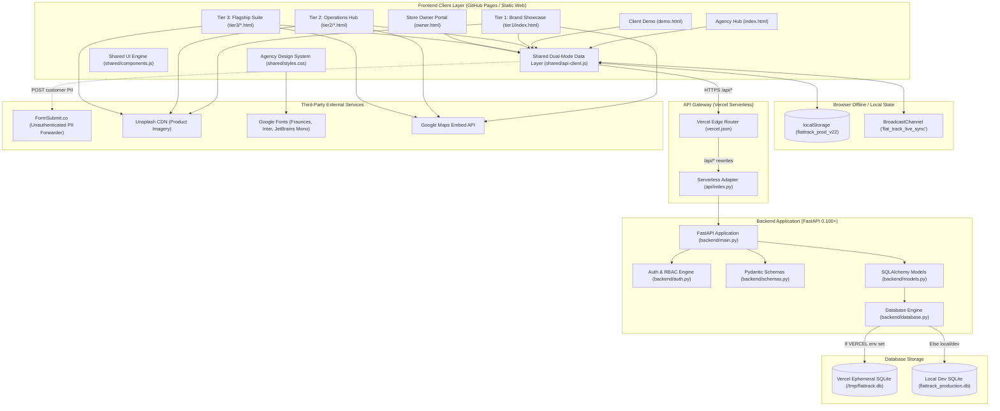

# Initial Project Architecture & Technical Assessment

**Project:** Austin Coffee Roasters / Flat Track Coffee Roasters Commercial Web Architecture  
**Evaluation Role:** Senior Software Architect, Application Security Engineer & DevOps Specialist  
**Workspace:** `C:\Users\HP\.gemini\antigravity\scratch\repo_01_coffee`  
**Live Frontend:** `https://satwik92105-png.github.io/01-austin-roasters-coffee/`  
**Live API Gateway:** `https://01-austin-roasters-coffee.vercel.app/api`  
**Repository:** `https://github.com/satwik92105-png/01-austin-roasters-coffee`  
**Assessment Date:** November 2026  

---

## 1. System Architecture Overview

The Austin Coffee Roasters application is structured as a decoupled, multi-tier Jamstack web application combining a static HTML5/CSS/JavaScript client hosted on **GitHub Pages** with a serverless Python FastAPI backend running on **Vercel Functions**.

### Architecture Data Flow Diagram

---

## 2. Technology Stack & Runtime Dependencies

### 2.1 Backend Environment
- **Runtime:** Python 3.9 / 3.11
- **Framework:** FastAPI (`>=0.100.0`)
- **ASGI Server:** Uvicorn (`>=0.22.0`)
- **Data Validation & Schemas:** Pydantic v2 (`>=2.0.0`)
- **ORM & Database Toolkit:** SQLAlchemy (`>=2.0.0`)
- **JWT Cryptography:** PyJWT (`>=2.8.0`)
- **Form Parsing:** python-multipart (`>=0.0.6`)
- **Database Engine:** SQLite 3 (via standard library `sqlite3` and SQLAlchemy)

### 2.2 Frontend Environment
- **Language / Standards:** Pure Vanilla ES6+ JavaScript (no React, Vue, or Angular dependencies)
- **Styling:** Vanilla CSS3 with extensive CSS Custom Properties (Variables), Flexbox, CSS Grid, and Glassmorphism backdrops (`backdrop-filter`)
- **Icons:** FontAwesome 6.4.0 (CDN-hosted)
- **Typography:** Google Fonts (`Fraunces`, `Plus Jakarta Sans`, `JetBrains Mono`)
- **Offline / Sync Engine:** HTML5 `localStorage` + `BroadcastChannel` API for real-time tab synchronization

---

## 3. Frontend Architecture & Page Inventory

The frontend is divided across three distinct commercial pricing tiers plus an agency showcase hub and back-office management portal:

| Route Path | Category | Description | Primary Components |
|---|---|---|---|
| `index.html` | Master Hub | Agency commercial sales landing page | 28-row comparison matrix, ROI payback calculator, pricing cards |
| `demo.html` | Client Pitch | Standalone pitch page | 3 tall luxury roastery tier cards, amenities checklists |
| `owner.html` | Back-Office | Store manager gateway | Quick launch links to Tier 2 and Tier 3 admin portals |
| `tier1/index.html` | Tier 1 ($500) | Editorial single-page roastery showcase | Live Austin CST badge, menu filter tabs, 15% weekend pass modal |
| `tier2/index.html` | Tier 2 ($1,500) | Corporate multi-page homepage | Hero banner, signature drink showcase, slide-out cart drawer |
| `tier2/menu.html` | Tier 2 ($1,500) | Direct ordering menu | 10 canonical menu items, drink customizer modal, cart drawer |
| `tier2/reserve.html` | Tier 2 ($1,500) | Table reservation engine | Date/time pickers, party size selector, confirmation card |
| `tier2/story.html` | Tier 2 ($1,500) | Craft heritage & moto culture | Brand timeline, roaster profiles, sourcing statement |
| `tier2/contact.html` | Tier 2 ($1,500) | Location, hours & contact | Google Maps embed, operating hours, inquiry form |
| `tier2/admin.html` | Tier 2 ($1,500) | POS & back-office operations | PIN auth (`1234`), order queue, 86'd stock toggle |
| `tier3/index.html` | Tier 3 ($3,500) | Flagship enterprise storefront | Ambient video hero, multi-location switch, WhatsApp concierge |
| `tier3/menu.html` | Tier 3 ($3,500) | Flagship commercial menu & checkout | Flavor radar meters (Acidity, Body, Roast), Stripe checkout modal |
| `tier3/reserve.html` | Tier 3 ($3,500) | VIP table & cupping reservation | Zone selector, dietary notes, instant booking reference |
| `tier3/story.html` | Tier 3 ($3,500) | Interactive origin story | Interactive cupping wheel, direct-trade sourcing map |
| `tier3/contact.html` | Tier 3 ($3,500) | Department routing & inquiries | Department selector, Google Maps directions, phone links |
| `tier3/subscribe.html`| Tier 3 ($3,500)| Coffee Club subscription configurator| Frequencies, bag count, grind profiles, live pricing |
| `tier3/catering.html` | Tier 3 ($3,500)| Enterprise event catering calculator | 25–500 guest slider, service tier selection, instant quote |
| `tier3/track.html` | Tier 3 ($3,500)| Live customer order tracker | 4-stage visual stepper, order lookup, Roast Points rewards |
| `tier3/kitchen.html` | Tier 3 ($3,500)| Barista Kitchen Display System (KDS) | Station filter pills, bump bar buttons, audio alert toggle |
| `tier3/admin.html` | Tier 3 ($3,500)| Enterprise back-office suite | 5 tabs, CSV export, 86'd inventory, 46.6px header clearance |

*Note: Root redirect files `tier1.html`, `tier2.html`, and `tier3.html` serve as legacy HTTP meta-refresh redirects to their respective directory index files.*

---

## 4. Backend Architecture & Service Structure

The backend code is situated in `backend/` and bridged to Vercel Serverless via `api/index.py`:

- **`backend/main.py` (812 lines):** Core FastAPI router, rate limiting middleware, OWASP response headers middleware, data seeding, and route handlers.
- **`backend/auth.py` (176 lines):** Salted PBKDF2-HMAC-SHA256 password hashing, PyJWT access token generation (15-min expiration), brute-force lockout tracker, and RBAC dependency decorators (`require_admin`, `require_staff`).
- **`backend/database.py` (20 lines):** SQLAlchemy sessionmaker, declarative base, and dynamic connection string targeting `/tmp/flattrack.db` on Vercel or `./flattrack_production.db` locally.
- **`backend/models.py` (101 lines):** SQLAlchemy ORM models for 8 entities (`menu_items`, `orders`, `reservations`, `inquiries`, `subscribers`, `users`, `audit_logs`, `idempotency_records`).
- **`backend/schemas.py` (117 lines):** Pydantic models with `ConfigDict(extra="forbid")` for input validation.

---

## 5. Database Schema & Migration Reality

The application uses **SQLite 3**. There is **no Alembic or formal database migration tool**.

### Database Tables Inventory
1. **`menu_items`:** `id`, `name`, `category`, `price`, `description`, `badge`, `in_stock`, `image`, `customizable`, `is_deleted`, `deleted_at`.
2. **`orders`:** `id` (e.g. `FT-1024`), `customer_name`, `phone`, `items_json`, `subtotal`, `tax`, `total`, `status`, `order_time`, `notes`, `is_deleted`, `deleted_at`.
3. **`reservations`:** `id` (e.g. `RES-401`), `name`, `email`, `phone`, `party_size`, `date`, `time`, `status`, `notes`, `is_deleted`, `deleted_at`.
4. **`inquiries`:** `id`, `name`, `email`, `subject`, `message`, `date`.
5. **`subscribers`:** `id`, `roast`, `grind`, `frequency`, `monthly_price`, `customer_name`, `email`, `created`.
6. **`users`:** `id`, `email`, `hashed_password`, `role`.
7. **`audit_logs`:** `id`, `actor`, `action`, `resource_type`, `resource_id`, `ip_address`, `details`, `timestamp_utc`.
8. **`idempotency_records`:** `id`, `idempotency_key`, `path`, `status_code`, `response_json`, `created_at`.

### Migration Vulnerability:
Migrations are executed ad-hoc on module load in `backend/main.py` lines 32–51 via raw SQL string concatenation inside a `try/except: pass` block. If columns already exist or if concurrent serverless workers attempt simultaneous schema modifications, silent failures can occur.

---

## 6. Complete API Endpoint Inventory

| HTTP Method | Route Path | Access / Role | Handler Function (`backend/main.py`) | Description |
|---|---|---|---|---|
| `GET` | `/` / `/api` / `/api/v1` | Public | `root_status` (line 233) | API service metadata & UTC timestamp |
| `GET` | `/health` / `/api/health` | Public | `health_check` (line 244) | Service health check |
| `POST` | `/auth/login` | Public | `login` (line 256) | Email/password login with lockout, issues JWT & cookie |
| `POST` | `/auth/register` | Public | `register_customer` (line 284) | Customer registration |
| `POST` | `/auth/google` | Public | `google_oauth` (line 298) | Simulated Google OAuth token exchange |
| `GET` | `/menu` / `/api/menu` | Public | `get_menu` (line 317) | List active menu items (`is_deleted == False`) |
| `POST` | `/menu` / `/api/menu` | Admin | `create_menu_item` (line 334) | Create menu item |
| `PUT` / `PATCH` | `/menu/{item_id}` | Admin | `update_menu_item` (line 367) | Upsert menu item by ID |
| `DELETE` | `/menu/{item_id}` | Admin | `delete_menu_item` (line 433) | Soft-delete menu item |
| `PATCH` / `POST` | `/menu/{item_id}/stock` | Admin | `toggle_stock` (line 453) | Toggle 86'd out-of-stock state |
| `GET` | `/orders` / `/api/orders` | **Public (Flaw!)** | `get_orders` (line 477) | List all orders with pagination |
| `GET` | `/orders/{order_id}` | Public | `get_single_order` (line 508) | Lookup single order by order ID |
| `POST` | `/orders` / `/api/orders` | Public | `place_order` (line 532) | Submit order with server recalculation & idempotency |
| `PATCH` | `/orders/{order_id}/status` | Staff/Admin | `update_order_status` (line 609) | KDS bump bar status update |
| `POST` | `/checkout/create-session`| Public | `create_checkout_session` (line 624)| Synthetic Stripe session simulation |
| `GET` | `/reservations` | Public | `get_reservations` (line 638) | List booked table reservations |
| `POST` | `/reservations` | Public | `create_reservation` (line 658) | Create table reservation with idempotency |
| `PATCH` | `/reservations/{res_id}/status`| Staff/Admin | `update_reservation_status` (line 708)| Update reservation confirmation status |
| `GET` | `/inquiries` / `/messages` | Public | `get_inquiries` (line 724) | Query contact inquiries |
| `POST` | `/inquiries` / `/messages` | Public | `create_inquiry` (line 738) | Save customer contact inquiry |
| `GET` | `/subscriptions` | Public | `get_subscriptions` (line 759) | List coffee club subscribers |
| `POST` | `/subscriptions` | Public | `create_subscriber` (line 774) | Register coffee club subscriber |
| `POST` | `/catering` | Public | `create_catering` (line 794) | Submit catering event inquiry |
| `GET` | `/audit-logs` | Admin | `get_audit_logs` (line 801) | Query paginated security audit log trail |

---

## 7. Authentication & Authorization Mechanisms

1. **Password Security:** Salted PBKDF2-HMAC-SHA256 with 100,000 iterations (`backend/auth.py` lines 71–80). Legacy salted SHA-256 fallback exists for backward compatibility.
2. **Access Tokens:** Signed JSON Web Tokens (PyJWT) using HMAC-SHA256 (`HS256`) with a 15-minute expiration window.
3. **Cookie Security:** The `/auth/login` endpoint sets `flattrack_access_token` with `HttpOnly=True`, `Secure=True`, and `SameSite=Strict`.
4. **Brute-Force Lockout:** IP-based lockout limits consecutive failed attempts to 5 within a 15-minute window (`MAX_FAILED_ATTEMPTS = 5`, `LOCKOUT_DURATION_SECONDS = 900`).
5. **Critical Auth Vulnerabilities:**
   - **Hardcoded PINs:** `backend/auth.py` lines 150–153 hardcodes `"1234"` and `"roastmaster123"` as admin credentials, and `"barista123"` as staff credentials.
   - **Lockout Bypass:** The brute-force lockout is ONLY evaluated within `/auth/login`. Operational endpoints accepting `?pin=` or `X-Admin-PIN` bypass lockout entirely.
   - **Default Admin Account:** Seeded at startup in `backend/main.py` line 183 with email `admin@flattrackcoffee.com` and default password `roastmaster123`.

---

## 8. Third-Party Integrations & External Dependencies

| Integration | Implementation Location | Operational Role | Security & Privacy Impact |
|---|---|---|---|
| **FormSubmit.co** | `shared/api-client.js:929` | Background AJAX email notification | **HIGH RISK:** Unauthenticated cleartext forwarding of customer PII across third-party infrastructure. |
| **Unsplash** | HTML files & `INITIAL_MENU` | Menu and roastery imagery | External CDN dependency. Potential tracking or image deprecation. |
| **Google Fonts** | `shared/styles.css:7` | Web fonts (`Fraunces`, `Inter`, `JetBrains Mono`) | External network request on every uncached page load. |
| **Google Maps** | `tier1/`, `tier2/`, `tier3/` contact pages | Embedded store map (1611 E Cesar Chavez St) | Standard iframe embed; safe under current CSP. |
| **FontAwesome** | HTML `<head>` blocks | UI icons | External CDN dependency (`cdnjs.cloudflare.com`). |

---

## 9. Security Controls Currently Implemented

The codebase displays several genuine security controls:
1. **Sliding-Window Rate Limiting:** 120 requests per 60-second window tracked by IP (`backend/main.py` lines 71–98).
2. **Security Headers Middleware:** Automatically attaches `X-Content-Type-Options: nosniff`, `X-Frame-Options: SAMEORIGIN`, `Referrer-Policy: strict-origin-when-cross-origin`, `Strict-Transport-Security`, and a Content Security Policy (`backend/main.py` lines 103–115).
3. **HTML Sanitization:** `sanitize_str()` executes `html.escape()` on all text inputs prior to database commitment (`backend/main.py` lines 120–123).
4. **Schema Strictness:** Pydantic schemas enforce `ConfigDict(extra="forbid")` to eliminate mass assignment risks.
5. **Server-Side Price Recalculation:** `place_order` queries `MenuItemModel` to verify prices and recompute subtotal, tax (8.25%), and total (`backend/main.py` lines 540–561).
6. **Idempotency Protection:** `IdempotencyRecordModel` caches order and reservation responses for 24 hours based on the `Idempotency-Key` header (`backend/main.py` lines 149–175).
7. **Audit Logging:** System mutative actions are logged to `AuditLogModel` with actor, action, resource ID, IP, and UTC timestamp (`backend/main.py` lines 125–147).

---

## 10. Critical Architectural & Operational Gaps

1. **Ephemeral `/tmp` SQLite Database:** Vercel serverless containers wipe `/tmp/flattrack.db` whenever instances cycle, causing 100% loss of placed orders, customer accounts, table reservations, and 86'd stock updates.
2. **Broken Object-Level Authorization (BOLA):** `GET /api/orders` requires no authentication and returns full customer names, phone numbers, notes, and purchases.
3. **Third-Party PII Exfiltration:** Client-side JavaScript transmits order details to `https://formsubmit.co/ajax/...`.
4. **Simulated Payment Processing:** `POST /api/checkout/create-session` generates synthetic mock tokens (`cs_test_...`) without real Stripe API calls or cryptographic webhook signature verification.
5. **Wildcard CORS with Credentials:** `CORSMiddleware` in `backend/main.py` configures `allow_origins=["*"]` with `allow_credentials=True`, violating browser security standards and creating CSRF exposure.
6. **Live Version Drift:** Deployed Vercel API reports version `3.1.0` while repository source is `v19.0.0` / `v22.0`.
7. **Hardcoded Secrets:** Default `SECRET_KEY = "flattrack_super_secret_jwt_key_2026_austin_tx_roasters"` in `backend/auth.py` line 12 is exposed in the source repository.

---

## 11. Technical Debt Inventory

| File Path | Line Range | Description | Risk / Impact |
|---|---|---|---|
| `backend/database.py` | 5–8 | Hardcoded `/tmp/flattrack.db` fallback for Vercel | Catastrophic data loss on serverless restart |
| `backend/auth.py` | 12 | Insecure fallback JWT `SECRET_KEY` | Allows forging admin tokens if env var unset |
| `backend/auth.py` | 150–154 | Hardcoded plain-text PINs (`1234`, `roastmaster123`) | Complete bypass of credential security |
| `backend/main.py` | 64–66 | `allow_origins=["*"]` with `allow_credentials=True` | Invalid CORS configuration and credential leakage |
| `backend/main.py` | 183–187 | Default admin password seeded into database on startup | Well-known credential exposure (`roastmaster123`) |
| `backend/main.py` | 477–484 | Public `GET /orders` endpoint without authentication | Severe privacy violation and PII data exposure |
| `shared/api-client.js` | 929–939 | Cleartext AJAX calls to `formsubmit.co` | Unregulated PII transmission to third party |
| `backend_server.py` | 1–100+ | Legacy duplicate backend server at repository root | Confusion regarding authoritative backend code |
| `tier1.html`, `tier2.html`, `tier3.html` | 1–15 | Root meta-refresh redirect stubs | Legacy clutter; potential SEO crawl confusion |
| `backend/main.py` | 32–51 | Ad-hoc `ALTER TABLE` execution inside application code | Lack of formal schema versioning / migration safety |

---

## 12. Assessment Verdict & Next Steps

The Austin Coffee Roasters application possesses an exceptionally high degree of frontend visual sophistication, well-crafted Austin branding, and genuine backend architectural features (rate limiting, idempotency, audit logging, server-side recalculation).

However, it is currently **unfit for live commercial financial transactions** due to its ephemeral database architecture, unauthenticated order exposure, simulated Stripe implementation, and third-party PII transmission.

The remediation plan must systematically migrate data persistence to an external cloud database (e.g. Neon PostgreSQL / Supabase), eliminate client-side PII forwarding, enforce proper JWT authentication with PIN removal, and attach real Stripe payment verification.
