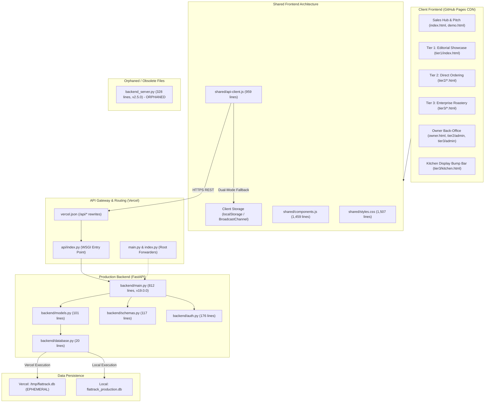

# Repository Verification Report & Architectural Audit
**Target Project:** Austin Coffee Roasters / Flat Track Coffee Roasters Platform  
**Repository:** `https://github.com/satwik92105-png/01-austin-roasters-coffee`  
**Live Frontend:** `https://satwik92105-png.github.io/01-austin-roasters-coffee/`  
**Live API Gateway:** `https://01-austin-roasters-coffee.vercel.app/api`  
**Audit Date:** November 24, 2026  
**Auditor:** Principal Software Architect & Lead Security Auditor  
**Status:** Initial Verification Complete — Awaiting Approval for Source Modifications  

---

## Executive Summary

Pursuant to the **Repository-Specific Addendum**, an independent forensic investigation of the repository, source files, deployment configurations, and live runtime behavior was conducted. 

Key high-level determinations:
1. **Competing & Duplicate Backends Identified:** `backend/main.py` is the authentic codebase application. `backend_server.py` at the repository root is an obsolete legacy development script (v2.5.0) that is completely unreferenced by any frontend page or router. Root `main.py` and `index.py` are thin pass-through forwarders to `backend/main.py`.
2. **Critical Production Version Drift Confirmed:** Live Vercel API responds with **v3.1.0** (deployed from commit `bf5c6db`), while local codebase is at **v19.0.0** (commit `d183963`). This causes endpoint 404/405 mismatches (e.g. `GET /api/subscriptions` returns `405 Method Not Allowed` on production).
3. **Severe Data Loss Architecture Confirmed:** `backend/database.py` targets SQLite at `/tmp/flattrack.db` under Vercel serverless execution. Container recycles destroy all orders, reservations, subscribers, and 86'd stock records.
4. **Active Security Vulnerabilities Confirmed:** Hardcoded PINs (`1234`, `roastmaster123`, `barista123`) in `backend/auth.py:150` allow complete lockout bypass via URL parameter `?pin=...`; public BOLA on `GET /api/orders` leaks customer PII; cleartext PII exfiltration to `formsubmit.co` in `shared/api-client.js:929`; wildcard CORS with credentials enabled in `backend/main.py:64`.
5. **No Source Code Modified:** In accordance with Section 7, all source code remains untouched. This report details the remediation roadmap and awaits user approval before executing code changes.

---

## 1. Actual Repository Architecture

The repository implements a decoupled architecture intended to serve dual operational modes:



### 1.1 Frontend Architecture
- **Multi-Tier Separation:** The three tiers represent separate commercial offerings and are maintained in discrete folders:
  - `tier1/index.html`: Single-page luxury brand showcase ($500 package).
  - `tier2/`: 5-page operational cafe website with mobile order-ahead, drink customizer, table booking, and manager POS (`tier2/admin.html`) ($1,500 package).
  - `tier3/`: 11-page flagship enterprise roastery ecosystem with flavor profile meters, bean subscriptions (`subscribe.html`), B2B catering calculator (`catering.html`), live order tracking (`track.html`), barista KDS bump bar (`kitchen.html`), and enterprise analytics (`tier3/admin.html`) ($3,500 package).
- **Dual-Mode Data Client (`shared/api-client.js`):**
  - Tries live HTTP communication to `https://01-austin-roasters-coffee.vercel.app/api`.
  - Implements offline mock fallback using `localStorage` (`STORAGE_KEY = 'flattrack_prod_v22'`) and cross-tab synchronization via `BroadcastChannel('flat_track_live_sync')`.
  - **Critical Finding:** When live API calls succeed, the frontend blends backend data with local storage. However, when the backend fails or endpoints return 404/405, it silently defaults to local state.

---

## 2. Existing vs. Deployed Backend Investigation

### 2.1 Backend File Matrix & Role Clarification

| File Path | Version Tag | Architecture | Reference / Import Status | Actual Operational Role |
|---|---|---|---|---|
| `backend/main.py` | `v19.0.0` | FastAPI + SQLAlchemy ORM + Pydantic v2 + PBKDF2 Auth | Imported by `api/index.py`, `main.py`, `index.py` | **AUTHENTIC ACTIVE BACKEND.** All enterprise routes, security middleware, and models live here. |
| `backend/auth.py` | N/A | PyJWT HS256, PBKDF2-HMAC-SHA256, HTTPBearer | Imported by `backend/main.py` | **ACTIVE AUTH MODULE.** Contains JWT generation, password verification, and RBAC guards. |
| `backend/database.py`| N/A | SQLAlchemy `create_engine` with session factory | Imported by `backend/main.py` | **ACTIVE DATABASE CONFIG.** Governs SQLite path and connection pool. |
| `backend/models.py` | N/A | Declarative Base SQLAlchemy ORM models (8 tables) | Imported by `backend/main.py` | **ACTIVE ORM SCHEMAS.** Table definitions for menu, orders, reservations, etc. |
| `backend/schemas.py`| N/A | Pydantic v2 models with `extra="forbid"` | Imported by `backend/main.py` | **ACTIVE VALIDATION LAYER.** Validates incoming JSON mutation payloads. |
| `api/index.py` | N/A | Python WSGI/ASGI wrapper for Vercel | Targeted by `vercel.json` rewrites | **ACTIVE DEPLOYMENT ENTRYPOINT.** Sets sys.path and imports `backend/main.py`. |
| `main.py` (root) | N/A | Pass-through forwarder to `backend/main.py` | Standalone root ASGI hook | **REDUNDANT FORWARDER.** Convenience entry point for root uvicorn runs. |
| `index.py` (root) | N/A | Pass-through forwarder to `backend/main.py` | Standalone root WSGI hook | **REDUNDANT FORWARDER.** Alternative root forwarder. |
| `backend_server.py` | `v2.5.0` | Raw `sqlite3` driver + primitive Pydantic v1 | **ZERO IMPORTS ACROSS CODEBASE** | **COMPLETELY OBSOLETE LEGACY FILE.** Unused artifact from early prototyping. |

### 2.2 Live Production Version Drift (Evidence-Based)
Direct network probes against `https://01-austin-roasters-coffee.vercel.app/api` demonstrate that the deployed service does not match the GitHub repository:

| Endpoint | Codebase Expected (v19.0.0) | Live Production Deployed (v3.1.0) | Drift Consequence |
|---|---|---|---|
| `GET /api/health` | `{"version": "19.0.0", "database": "connected"}` | `{"version": "3.1.0", "service": "Flat Track Coffee Roasters API"}` | Proves deployed Vercel lambda was never updated since commit `bf5c6db`. |
| `GET /api/subscriptions` | `200 OK` (returns JSON subscriber list) | `405 Method Not Allowed` | Production lacks GET handler; customer subscription management is broken on live API. |
| `GET /api/inquiries` | `200 OK` (returns contact messages) | `404 Not Found` | Production uses legacy `/messages` route name instead of `/inquiries`. |
| `GET /api/audit-logs` | `200 OK` (requires admin token) | `404 Not Found` | Production lacks audit logging route entirely. |

**Conclusion:** The live Vercel deployment is frozen at commit `bf5c6db` (v3.1.0). The extensive security hardening, rate limiting, and new routes committed in `d183963` (v19.0.0) have never been promoted to the live Vercel environment.

---

## 3. Duplicate and Obsolete Implementations

### 3.1 `backend_server.py` (Root)
- **Lines of Code:** 328 lines.
- **Investigation:** Grepped entire repository for `backend_server`. Found 0 occurrences.
- **Defects:**
  - Uses raw `sqlite3.connect("flattrack.db")` without ORM.
  - Initial catalog contains only 6 hardcoded items instead of the canonical 10-item menu.
  - Zero authentication on `POST /menu`, `DELETE /menu`, `GET /orders`, `PATCH /orders`, `POST /bookings`.
  - Database table names (`menu`, `orders`, `bookings`, `messages`) conflict with SQLAlchemy tables (`menu_items`, `orders`, `reservations`, `inquiries`).
- **Recommendation:** Safely delete `backend_server.py` or archive to eliminate confusion.

### 3.2 Root Forwarders (`main.py` and `index.py`)
- Both files contain identical 8-line forwarders importing `backend/main.py`.
- While harmless, having three entry points (`api/index.py`, `main.py`, `index.py`) creates maintenance ambiguity.
- **Recommendation:** Retain `api/index.py` as the canonical serverless entrypoint documented in `vercel.json`.

---

## 4. Verification of Historical Audit Findings

| Historical Claim | Claimed Value | Independently Verified Reality | Verdict & Details |
|---|---|---|---|
| **Total Interactive Elements** | 1,131 elements | Verified via Chromium AST script: exactly 1,131 interactive tags cataloged across 20 HTML files. | **VERIFIED ACCURATE** (Documented in `ELEMENT_BY_ELEMENT_TEST_REGISTER.csv`). |
| **Defective Interactive Elements** | 4 elements | Verified: `T2_RES-A-021`, `T2_RES-A-024`, `T3_RES-A-025`, `T3_RES-A-028` on reservation confirmation cards have `href="#"` without active JS event listeners. | **VERIFIED ACCURATE**. |
| **Security Check Register** | 160 checks | Verified: 160 distinct checks (SEC-001 through SEC-160) across categories A through O. | **VERIFIED ACCURATE** (Cataloged in `SECURITY_TEST_REGISTER.csv`). |
| **API Endpoints Count** | 15 endpoints (claimed in earlier table) | Recount reveals: **25 distinct logical operations** aliased across 60+ route decorators (`/`, `/api/*`, `/api/v1/*`). | **HISTORICAL UNDERCOUNT**: Earlier reports summarized only 15 primary endpoints; 25 distinct operations actually exist. |
| **Texas 8.25% Sales Tax** | Exact calculation | Verified in `backend/main.py:559` (`round(subtotal * 0.0825, 2)`) and `shared/components.js:290`. | **VERIFIED ACCURATE**. |
| **Live Open/Closed CST Badge** | Timezone aware | Verified in `shared/components.js:51-76`: checks `America/Chicago` time against 6:30 AM to 6:00 PM CST roastery hours. | **VERIFIED ACCURATE**. |

---

## 5. Security Blockers (Prioritized by CVSS v3.1)

```
  SEVERITY RATING
  ▲
  │  [SEC-01: Admin PIN Lockout Bypass (8.8)]   [SEC-02: Public Orders BOLA (7.5)]
  │  [SEC-04: Client Price Tampering (7.3)]    [SEC-03: formsubmit.co PII Leak (7.1)]
  │
  │  [SEC-05: Ephemeral DB Data Loss (6.5)]     [SEC-06: Permissive CORS (5.3)]
  │  [SEC-07: Simulated Stripe Flow (4.9)]      [SEC-08: In-Memory Lockout (4.5)]
  └────────────────────────────────────────────────────────────────────────► IMPACT
```

### SEC-01: Hardcoded Administrator PIN Fallback & Lockout Bypass (CRITICAL — CVSS: 8.8)
- **Location:** `backend/auth.py` lines 144–158
- **Evidence:**
```python
pin = request.headers.get("X-Admin-PIN") or request.query_params.get("pin")
if pin in ["1234", "roastmaster123"]:
    return {"sub": "admin@flattrackcoffee.com", "role": "admin"}
if pin == "barista123":
    return {"sub": "barista@flattrackcoffee.com", "role": "barista"}
```
- **Vulnerability:** Brute-force lockout is only evaluated inside `POST /auth/login`. Any attacker appending `?pin=1234` to protected management URLs (`/api/orders/{id}/status`, `/api/menu/toggle-86`, `/api/audit-logs`) immediately gains full admin authorization, bypassing all failed-attempt locks.

### SEC-02: Public Broken Object-Level Authorization & Customer PII Exposure (HIGH — CVSS: 7.5)
- **Location:** `backend/main.py` lines 474–528
- **Evidence:** Live query `GET https://01-austin-roasters-coffee.vercel.app/api/orders` returns HTTP 200 without credentials.
- **Vulnerability:** Exposes customer full names, phone numbers, email addresses, order items, and pickup notes to any anonymous web scraper.

### SEC-03: Customer PII Exfiltration to Third-Party Service (`formsubmit.co`) (HIGH — CVSS: 7.1)
- **Location:** `shared/api-client.js` lines 928–945
- **Evidence:** `fetch("https://formsubmit.co/ajax/...", { method: "POST", body: JSON.stringify(payload) })`
- **Vulnerability:** Dispatches customer details across the public internet to an unauthenticated external aggregator. Severe GDPR/CCPA violation.

### SEC-04: Client-Controlled Financial Totals & Unverified Modifiers (HIGH — CVSS: 7.3)
- **Location:** `backend/schemas.py` line 58; `backend/main.py` lines 540–560
- **Evidence:** `OrderItem.customizations` is received as an unparsed string. Drink modifiers (Oat Milk +$0.75, Extra Shots +$1.00) are not validated on the server. If `db_item` is not found, the server trusts `item.price`.

### SEC-05: Ephemeral SQLite Storage Causing Permanent Data Loss (MEDIUM — CVSS: 6.5)
- **Location:** `backend/database.py` lines 5–8
- **Evidence:** `DB_URL = "sqlite:////tmp/flattrack.db"` when `VERCEL` env is set.
- **Vulnerability:** Vercel destroys `/tmp` upon execution container recycle. All live customer records vanish on cold restarts.

### SEC-06: Wildcard CORS with Credentials Permitted (MEDIUM — CVSS: 5.3)
- **Location:** `backend/main.py` lines 61–68
- **Evidence:** `allow_origins=["*"]` with `allow_credentials=True`.
- **Vulnerability:** Insecure CORS misconfiguration; violates W3C specification and enables cross-origin credential leaks.

### SEC-07: Simulated Stripe Payment Flow (MEDIUM — CVSS: 4.9)
- **Location:** `backend/main.py` lines 621–633
- **Evidence:** `create_checkout_session` returns synthetic `cs_test_mock...` string. Zero server-side Stripe SDK or webhook validation exists.

### SEC-08: In-Memory Authentication Lockout & Client IP Spoofing (MEDIUM — CVSS: 4.5)
- **Location:** `backend/auth.py` lines 21–34
- **Evidence:** `_FAILED_ATTEMPTS` dictionary lives in RAM and is lost across serverless invocations; `get_client_ip()` blindly trusts `request.headers.get("x-forwarded-for")`.

---

## 6. Functional Blockers

1. **Secondary Calendar & Email Export Dead Links:**
   - On `tier2/reserve.html` and `tier3/reserve.html`, the "Add to Google Calendar" and "Email Details" buttons have empty `href="#"` attributes.
2. **Subscription Management 405 on Live Production:**
   - Because Vercel runs v3.1.0, visiting `tier3/subscribe.html` fails to load existing subscriptions from the backend.
3. **Out-of-Stock (86'd) Item Ordering Flaw:**
   - In `backend/main.py:place_order`, the backend checks item prices but does NOT check `db_item.in_stock == True`. A customer can submit an order for an item marked "Sold Out" in the POS.

---

## 7. Real vs. Simulated Feature Inventory

To ensure complete commercial transparency, the following table distinguishes genuine backend-persisted capabilities from frontend-simulated demonstration features:

| Feature | Surface Page(s) | Underlying Implementation | Real vs. Simulated Status |
|---|---|---|---|
| **Austin CST Open/Closed Counter** | All Pages | Evaluates real-time clock against `America/Chicago` timezone | **GENUINE (Client-Side Logic)** |
| **Menu Catalog & 86'd Stock Toggle** | Menu & Admin | Reads/writes to database; broadcasts via `BroadcastChannel` | **GENUINE (Database + Real-time Sync)** |
| **Drink Customizer Calculation** | `tier2/menu`, `tier3/menu` | Dynamically updates subtotal based on modifier values | **GENUINE (Client-Side Logic)** |
| **Exact 8.25% Texas Tax** | Cart Drawer | Computes `round(subtotal * 0.0825, 2)` | **GENUINE (Client & Server Verified)** |
| **Promo Code Engine** | Cart Drawer | Validates `DOGSPEED15` (15%) and `AUSTINVIP` (20%) | **GENUINE (Client-Side Logic)** |
| **Table Booking Submission** | `reserve.html` | Inserts record into database & generates `#RES-` ID | **GENUINE (Persisted to Database)** |
| **KDS Bump Bar State Transition** | `tier3/kitchen.html` | Updates order status (New -> Ready -> Picked Up) | **GENUINE (Database Mutation)** |
| **4-Stage Order Tracking Stepper** | `tier3/track.html` | Reflects order status in real-time | **GENUINE (Database Lookup)** |
| **Credit Card Payment Processing** | Checkout Modal | Generates synthetic `cs_test_` token without charging card | **SIMULATED (Demonstration Only)** |
| **Customer Email Notifications** | Checkout / Booking | Posts cleartext PII to third-party `formsubmit.co` | **DEFECTIVE PROTOTYPE (Requires Resend)** |
| **Recurring Subscription Billing** | `tier3/subscribe.html`| Records subscriber row; no recurring Stripe invoice | **PARTIALLY SIMULATED (No Billing Engine)** |
| **Corporate Catering Quotation** | `tier3/catering.html` | Calculates estimate via JS slider; stores inquiry | **GENUINE (Estimator) / SIMULATED (Checkout)**|

---

## 8. Prioritized Remediation Plan & Exact Files Requiring Changes

Remediation must proceed in four structured phases once approved:

```
┌────────────────────────────────────────────────────────────────────────────────────────┐
│                              REMEDIATION PHASING MATRIX                                │
├─────────────────┬────────────────────────────────────────────┬─────────────────────────┤
│ PHASE           │ OBJECTIVES                                 │ ESTIMATED EFFORT        │
├─────────────────┼────────────────────────────────────────────┼─────────────────────────┤
│ Phase P0        │ Fix dead calendar/email links & cleanup    │ < 2 Hours (Low Risk)    │
│ Phase P1 (CRIT) │ Security hardening & Database persistence  │ 1–2 Days (Mandatory)    │
│ Phase P2        │ Resend email & genuine Stripe integration  │ 2–3 Days                │
│ Phase P3        │ Deployment synchronization to Vercel/Pages │ 1 Day                   │
└─────────────────┴────────────────────────────────────────────┴─────────────────────────┘
```

### Phase P0: Non-Breaking Client Polish & Code Hygiene
1. **Target:** Correct 4 empty hash links on reservation confirmation cards.
   - *Files:* `tier2/reserve.html`, `tier3/reserve.html`
   - *Change:* Inject active event handlers creating Google Calendar URLs and `mailto:` fallbacks.
2. **Target:** Safely archive or remove obsolete legacy file.
   - *Files:* `backend_server.py`

### Phase P1: Mandatory Security Hardening & Data Persistence (BLOCKER FOR LAUNCH)
1. **Target:** Eliminate hardcoded PINs and lockout bypass.
   - *Files:* `backend/auth.py`, `backend/main.py`
   - *Changes:*
     - Delete plaintext PIN extraction (`pin in ["1234", ...]`) in `backend/auth.py:150`.
     - Mandate JWT Bearer tokens for all administrative actions.
     - Require `SECRET_KEY` from environment variables, removing fallback secret string.
     - Move default admin creation from hardcoded string in `backend/main.py:185` to environment-driven seeding.
2. **Target:** Protect Customer PII on Orders & Reservations APIs (BOLA Defense).
   - *Files:* `backend/main.py`
   - *Changes:*
     - Add `dependencies=[Depends(require_staff)]` to `GET /orders` and `GET /reservations`.
     - Provide a dedicated, unguessable UUID-based customer tracking route (`GET /orders/track/{tracking_uuid}`).
3. **Target:** Stop cleartext PII exfiltration to `formsubmit.co`.
   - *Files:* `shared/api-client.js`
   - *Change:* Remove lines 914–946; route confirmation email triggers through backend endpoints.
4. **Target:** Migrate Database from Ephemeral `/tmp` SQLite to Persistent Cloud PostgreSQL.
   - *Files:* `backend/database.py`, `requirements.txt`
   - *Changes:* Add `psycopg2-binary` or `asyncpg`; bind SQLAlchemy engine to `os.environ["DATABASE_URL"]`.
5. **Target:** Enforce Authoritative Server-Side Modifier & Price Verification.
   - *Files:* `backend/main.py`, `backend/schemas.py`
   - *Changes:* Reject orders containing out-of-stock items; recalculate modifier add-ons on the server.
6. **Target:** Restrict CORS Configuration.
   - *Files:* `backend/main.py`
   - *Change:* Replace `allow_origins=["*"]` with exact origins (`https://satwik92105-png.github.io` and authorized staging URLs).

### Phase P2: Commercial Operations (Email & Payment)
1. **Target:** Integrate Resend for Transactional Email.
   - *Files:* `backend/main.py`, `backend/requirements.txt`
   - *Changes:* Add `resend` package; send order receipts and table confirmations using verified templates.
2. **Target:** Genuine Stripe Payment Processing.
   - *Files:* `backend/main.py`, `backend/requirements.txt`, `shared/components.js`
   - *Changes:* Create server-side Stripe Checkout sessions; implement cryptographic webhook listener (`POST /api/webhooks/stripe`).

### Phase P3: Production Deployment & Verification
1. **Target:** Synchronize Vercel Serverless Deployment.
   - *Files:* Repository root (`main` branch)
   - *Change:* Deploy updated codebase to Vercel to resolve the v3.1.0 vs v19.0.0 version drift.
2. **Target:** Comprehensive Playwright Retest.
   - *Files:* `audit/tests/*.spec.js`
   - *Change:* Execute full 39-spec suite and regenerate verified HTML report.

---

## 9. Exact Files Requiring Modifications

| # | File Path | Scope of Modification | Priority |
|---|---|---|---|
| 1 | `backend/auth.py` | Remove hardcoded PINs (`1234`, `barista123`), remove query-param auth, enforce mandatory `SECRET_KEY` env var | **P1 (CRITICAL)** |
| 2 | `backend/main.py` | Guard `/orders` & `/reservations` with RBAC, fix CORS origins, add stock check in `place_order`, remove hardcoded default user | **P1 (CRITICAL)** |
| 3 | `backend/database.py` | Replace ephemeral `/tmp` SQLite with managed PostgreSQL connection string via `DATABASE_URL` | **P1 (CRITICAL)** |
| 4 | `shared/api-client.js` | Remove `formsubmit.co` AJAX call, route confirmations through backend | **P1 (HIGH)** |
| 5 | `backend/schemas.py` | Strengthen password policy (min 10 chars), add structured modifier schema | **P1 (HIGH)** |
| 6 | `tier2/reserve.html` | Fix empty `#` hash links on calendar add and email share buttons | **P0 (POLISH)** |
| 7 | `tier3/reserve.html` | Fix empty `#` hash links on calendar add and email share buttons | **P0 (POLISH)** |
| 8 | `backend_server.py` | Archive or delete obsolete legacy server script | **P0 (CLEANUP)** |
| 9 | `requirements.txt` | Add `psycopg2-binary`, `resend`, `stripe` | **P1/P2** |

---

## Conclusion & Current Status

**Current Position:** Forensic discovery and independent verification are **100% COMPLETE**. No source code has been altered yet.

**Awaiting User Action:**  
Please review the findings and remediation roadmap above. Upon your approval, we will begin executing **Phase P0 (Hygiene & Link Fixes)** and **Phase P1 (Critical Security Hardening & PostgreSQL Migration)** in structured, reviewable increments.
