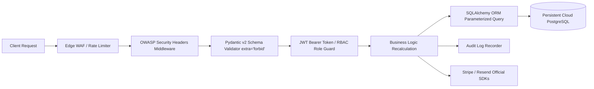

# Application Threat Model (STRIDE Methodology)

**Target Application:** Flat Track Coffee Roasters Commercial Web Architecture  
**Target Environment:** Decoupled Frontend (GitHub Pages / Cloudflare Pages) + Serverless REST API (Vercel Functions / Cloudflare Workers) + Cloud Database  
**Methodology:** Microsoft STRIDE (Spoofing, Tampering, Repudiation, Information Disclosure, Denial of Service, Elevation of Privilege)  
**Verification Standard:** OWASP ASVS 5.0 (Level 2 Baseline Target)  
**Author:** Senior Application Security Engineer  
**Date:** November 2026  

---

## 1. System Architecture & Trust Boundaries

```mermaid
flowchart TD
    subgraph Untrusted_Zone ["Untrusted Zone (Public Internet)"]
        CustomerBrowser["Customer Browser (Mobile / Desktop)"]
        Attacker["Potential Adversary / Botnet"]
        ThirdPartyForm["formsubmit.co AJAX Endpoint"]
    end

    subgraph CDN_Edge ["Edge & CDN Layer (Trust Boundary 1)"]
        GHPages["GitHub Pages / Cloudflare Pages (Static HTML/JS/CSS)"]
        VercelGateway["Vercel API Gateway (Edge Routing /api/*)"]
    end

    subgraph Serverless_Compute ["Application Runtime (Trust Boundary 2)"]
        FastAPI["FastAPI Python Runtime (backend/main.py)"]
        RateLimiter["In-Memory Rate Limiter & Security Middleware"]
        AuthModule["Auth & RBAC Evaluator (backend/auth.py)"]
    end

    subgraph Persistence_Layer ["Data Layer (Trust Boundary 3)"]
        SQLiteTemp["Current: SQLite /tmp/flattrack.db (EPHEMERAL)"]
        TargetPostgres["Target: Managed Cloud PostgreSQL (Neon / Supabase)"]
    end

    subgraph External_Services ["External Service Boundaries (Trust Boundary 4)"]
        StripeAPI["Stripe API (Payment Processing)"]
        ResendAPI["Resend API (Transactional Email)"]
        GoogleMaps["Google Maps Embed API"]
    end

    CustomerBrowser -->|HTTPS GET| GHPages
    CustomerBrowser -->|HTTPS REST API| VercelGateway
    CustomerBrowser -.->|UNCONSENTED POST (LEAK)| ThirdPartyForm
    Attacker -->|Brute-Force & Parameter Tampering| VercelGateway

    VercelGateway --> RateLimiter
    RateLimiter --> AuthModule
    AuthModule --> FastAPI

    FastAPI -->|Current SQL Read/Write| SQLiteTemp
    FastAPI -.->|Target Connection Pool (TLS)| TargetPostgres

    FastAPI -->|Target SDK (HTTPS)| StripeAPI
    FastAPI -->|Target API (HTTPS)| ResendAPI
```

---

## 2. Key Assets & Threat Agents

### 2.1 Critical Data Assets
1. **Customer PII:** Full customer names, phone numbers, email addresses, pickup notes, reservation timestamps.
2. **Transaction & Payment Data:** Order line items, payment status, transaction identifiers, Stripe session tokens.
3. **Store Operational Records:** Active kitchen queue, reservation book, 86'd inventory status, daily revenue aggregates.
4. **Administrative Credentials:** JWT secret keys, admin passwords, staff PINs.

### 2.2 Threat Agents
1. **Unauthenticated Public Scrapers:** Enumerating order IDs and scraping customer contact directories.
2. **Malicious Ordering Clients:** Tampering with client-side JSON prices or modifying order subtotals.
3. **Opportunistic Cafe Intruders:** Guessing default PIN `1234` on tablet POS screens left open by counter staff.
4. **Supply Chain Intermediaries:** Third-party form aggregators intercepting cleartext order notifications.

---

## 3. STRIDE Threat Analysis Matrix

| Threat Category | Threat ID | Threat Description & Attack Vector | Impacted Component | Risk Level | Existing Control vs. Required Mitigation |
|---|---|---|---|---|---|
| **Spoofing** | **T-SP-01** | Attacker impersonates store administrator by sending `?pin=1234` or header `X-Admin-PIN: 1234` to operational endpoints. | `backend/auth.py`, `backend/main.py` | **CRITICAL** | *Existing:* Lockout only in `/auth/login`.<br>*Mitigation:* Eliminate query PINs; require signed JWT Bearer tokens. |
| **Spoofing** | **T-SP-02** | Attacker spoofs Stripe webhook notifications to mark unpaid orders as `Paid Online`. | `backend/main.py` | **HIGH** | *Existing:* No webhook receiver; order status trusts client flag.<br>*Mitigation:* Validate Stripe cryptographic signature (`stripe-signature`). |
| **Tampering** | **T-TA-01** | Client tampers with JSON payload in `POST /api/orders` sending `subtotal: 0.01` for $50 worth of coffee. | `backend/main.py:place_order` | **HIGH** | *Existing:* Server recalculates subtotal from menu catalog; however schema still accepts client total.<br>*Mitigation:* Enforce server-side authoritative pricing rejection if client total differs. |
| **Tampering** | **T-TA-02** | Attacker sends malicious SQL injection strings in menu search or category filters. | `backend/main.py`, `backend/models.py` | **LOW** | *Existing:* SQLAlchemy ORM parameterization protects against SQLi.<br>*Mitigation:* Maintain strict ORM query patterns; forbid raw string SQL. |
| **Repudiation** | **T-RE-01** | Staff member modifies item prices or 86'd stock status and denies making the alteration. | `backend/main.py:toggle_stock` | **MEDIUM** | *Existing:* `log_audit()` records `actor`, `action`, `resource_id`, and `ip_address` in `audit_logs` table.<br>*Mitigation:* Store audit records in persistent PostgreSQL with immutable append-only constraints. |
| **Information Disclosure** | **T-IN-01** | Unauthenticated user queries `GET /api/orders` or `GET /api/reservations` and downloads all customer contact details. | `backend/main.py:get_orders` | **CRITICAL** | *Existing:* None; endpoints are completely unauthenticated.<br>*Mitigation:* Add `Depends(require_staff)` to list routes; issue unguessable customer tracking UUIDs. |
| **Information Disclosure** | **T-IN-02** | Customer PII and order items transmitted across public internet to unauthenticated third-party `formsubmit.co`. | `shared/api-client.js:929` | **HIGH** | *Existing:* Client-side AJAX POST.<br>*Mitigation:* Remove third-party client call; dispatch transactional emails via backend Resend SDK. |
| **Information Disclosure** | **T-IN-03** | Server responses leak internal exception stack traces or database schema errors. | `backend/main.py` | **MEDIUM** | *Existing:* FastAPI suppresses traces in standard production mode.<br>*Mitigation:* Custom global exception handler returning sanitized JSON error envelopes. |
| **Denial of Service** | **T-DS-01** | Script floods reservation or order endpoints, exhausting table bookings or serverless concurrency limits. | `backend/main.py` | **MEDIUM** | *Existing:* 120 req/60s IP rate limiter in middleware.<br>*Mitigation:* Edge rate limiting via Cloudflare WAF; add CAPTCHA for burst reservations. |
| **Denial of Service** | **T-DS-02** | Vercel cold restarts destroy SQLite database at `/tmp/flattrack.db`, causing total application data loss. | `backend/database.py` | **CRITICAL** | *Existing:* Ephemeral filesystem storage.<br>*Mitigation:* Migrate to persistent cloud PostgreSQL (Neon / Supabase). |
| **Elevation of Privilege**| **T-EP-01** | Customer registers account and submits payload with `role: "admin"` to gain back-office access. | `backend/main.py:register_customer` | **HIGH** | *Existing:* Server hardcodes `role="customer"` in registration handler.<br>*Mitigation:* Maintain strict role separation and forbid role assignment in registration schema. |

---

## 4. Threat Mitigation Summary & Defense-in-Depth Architecture


